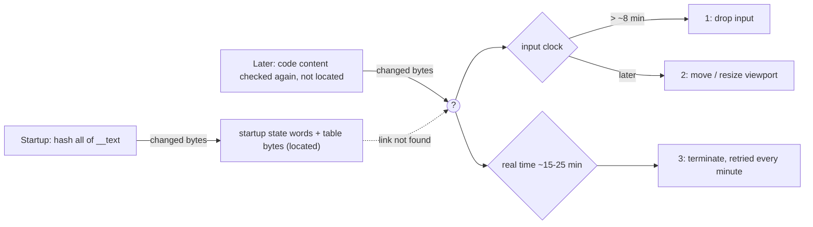

# Feral's anti-tamper in Total War: ATTILA (Mac): an overview

Steam build, Feral 1.6.1 RC2, `LC_UUID 392D6F66-…`. Addresses are unslid (image base `0x100000000`). This page
summarises what the game does when its code has been modified. The investigation behind it, run by run, is in
[integrity-and-quirks.md](integrity-and-quirks.md); the tools are in [re-tooling.md](re-tooling.md). Functions are named
in the Steam Binary Ninja database (`AntiTamper_*`, `CodeSign_*`, `SteamApi_*`, `FeralEventSource_Dispatch`).

## In short

The game checks whether its own machine code was changed. If it was, nothing happens at first. After some minutes of
play it starts degrading itself, step by step, and finally quits or crashes, with nothing that points to the cause:

| Stage | When (in a modified game) | What the player sees |
|---|---|---|
| 1 | ~8 min of input time | Clicks are ignored for a while, then work again; the ignored stretches get longer. The cursor's click animation stops too. Tabbing out and back helps briefly |
| 2 | later (~15–23 min of input time) | The rendered picture shrinks/grows and moves inside the unchanged window |
| 3 | ~15–25 min after launch | The game ends: a crash (out of memory, stack overflow) or a plain quit, retried about once a minute until one works |

A clean game shows none of this (sessions H and K: 11 and 21½ minutes). Diplomacy is not involved: it was simply where
most clicking happened.

Dashed and `?` mark what isn't known: the startup result is found in memory, but how it (or the later check) reaches
the responses is not. Hardware watchpoints on four of the five state words saw no reads during play. With the patch
applied after startup, the state words stay clean and the responses still come.

## Detection

**What triggers it: changed code bytes.** Rewriting a code page with identical bytes goes unnoticed (session O). Any
changed byte in `__text` counts, whether patched in memory (TWASE) or in the file on disk (the community building-slot
patch).

| Check | Where | Notes |
|---|---|---|
| Startup code hash | Five static initializers, `AntiTamper_StartupTextHash_55/100/199/227/236` (`0x100259b28`, `0x10042e430`, `0x100aa8d80`, `0x100bc2f04`, `0x100c157e8`), likely a sixth (`mod_init_func_532`) | xxHash64 over all of `__text` (`0x100012020`–`0x104144bb4`) against constants built into the binary. **Record:** each guard sets a bit in its state word (`0x105019000`, `0x10504ef00`, `0x105060d20`, `0x105065460`, `0x105065fb0`) and re-encodes one table byte (`0x104da2ef0`, `0x104f6d53d`, `0x104f762d2`, `0x104d9f52d`, `0x104f6be60`). Confirmed in the running game: patched vs clean values match emulation. Who reads this record is not found |
| Post-startup check | not located | Applying the patch after the startup hash (`late_patches`) fools that hash but not the game (sessions M/M2). Something checks the code content again later; where it stores its result is unknown |
| Run-time range guards | Seven, `AntiTamper_TextRangeGuard_*` (`0x100257c8c`, `0x100258848`, `0x10042b434`, `0x100aa56c0`, `0x100bbd54c`, `0x100c0c318`, `0x100f81860`) | Started by an obfuscated scheduler; hash `__text` relative to an "anchor" address read from the data slot GOT `0x104a7f590`. No effect of a changed byte was visible in emulation |
| Steam library check | `SteamApi_LoadVerifiedLibrary` `0x1000406fc` | xxHash64 of `libsteam_api.dylib` on disk must be `0x0b8f001cf3bc9596` before it is loaded; re-checked on a thread 10–11 s later |
| Hidden module | `AntiTamper_LoadVerifiedModule` `0x10033d924`, `AntiTamper_PeriodicModuleHashCheck` `0x10033dd00` | A blob is hash-checked, loaded with Feral's own Mach-O loader and re-hashed every 419 s |
| Code signature | `CodeSign_CheckSelf_AnchorAppleGeneric`, `CodeSign_CheckSelf_LeafCertPin` (`0x10039b9dc`, `0x10039bc68`), `CodeSign_StaticCheckRequirementString` `0x10056ef3c` | Signature and certificate checks. These look at the signature state, not live bytes, so in-memory patches pass them |
| Others | `AntiTamper_AnchorPageWriteProbe` `0x10025cd10`, `MainImage_WalkLoadDylibCommands` `0x100f13bd4`, a hidden counter (`AntiTamper_InitHiddenCounter`) | Probes and bookkeeping; the counter stayed 0 in every run |

## The responses

### Stage 1: dropped input

`FeralEventSource_Dispatch` (`0x10056c1c4`), which every keyboard and mouse event passes through, keeps a hidden clock:
the time of the first input event and the seconds since then (`elapsed`, behind a masked pointer). In a modified game,
input starts being dropped once `elapsed` passes roughly 480 s. The click reaches the app on time, and the game itself
throws it away. Two functions read the clock (`sub_10056c700`, `sub_100cc2268`); the exact rule isn't decoded.

Tests: clean game with the clock forced to 600–1250 s, no drops (H). Modified game with the clock forced to 600 s, drops
within a minute (I). Modified game with the clock kept at 0, no drops for 14 minutes (G).

### Stage 2: viewport

Later in the same clock (between ~930 and ~1380 s), the game shrinks/grows and moves its own picture. The macOS window,
the Metal layer and its drawable stay exactly the same size (`[Window]` log), so this happens in the game's own
viewport/scale values. It is also prevented by keeping the clock at 0. The code doing it isn't located.

### Stage 3: termination

Independent of the input clock: it also happens with the clock held at 0 (sessions L, P, Q, R). From about 15–18
minutes after launch, delayed jobs start on detached threads (`Thread_StartDetached` `0x100092f14`) and the obfuscated
scheduler on the main loop runs commands. They are tried roughly once a minute, so blocking one isn't enough:

| Form | Code | Effect | Seen in |
|---|---|---|---|
| Memory exhaustion | job call slot `0x104b1e450` → `AntiTamper_Response_ExhaustMemory_DelayedThread` `0x100f67afc` → `AntiTamper_Response_ExhaustMemory` `0x100f67ba4` | Seeds a Mersenne Twister, then allocates ever larger blocks until `malloc` fails and writes through the NULL: `SIGSEGV` | L |
| Stack exhaustion | delayed job `AntiTamper_Response_ExhaustStack_DelayedJob` `0x100fbc9c0` (launched every minute via `sub_100fbc5c4` → `sub_100fbc938`) → call slot `0x104b21490` → `AntiTamper_Response_ExhaustStack` `0x100fbcb58` | Recurses until the thread's stack guard: `SIGBUS` (logged as `SIGILL`) | P |
| `_exit(3)` | scheduler command `AntiTamper_Response_Exit3Command` `0x1007b3178` (call slot `0x104ab7a20`), run from the main loop: `Feral_MainLoopRunProc` → … → `FeralScheduler_RunDue` `0x10023ff94` → `sub_1002400e0` | Quits silently with status 3, no crash report | Q, R |
| Fake kernel error + `exit(1)` | `AntiTamper_Response_FakeKernelErrorExit` `0x100fac7f0`: `syslog(LOG_ERR, "%s", "localhost kernel: internal ICX failure")`, then `exit(1)`; reached from the same scheduler chain (probably by a tail call from an obfuscated command) | Writes a made-up kernel message to the system log and quits. In session J another thread then crashed on data the exit had already destroyed, which looked like an ordinary bug | J |

The main loop itself is `Feral_MainLoopRunProc` (`0x100f66b64`), installed by the game's `main` (`main_feral`,
`0x100fd9224`) with `+[CFeralNSApplication setRunProc:]`.

## How it hides

- **Obfuscation:** about 400 functions carry noise operations on thread-local scratch arrays. Pointers to the hidden
  state are stored XOR- or offset-masked (`(&a ^ ~[b]) − [c]`, shifted). Decisions are branch-free selects
  (`x = cond ? a : b` computed with bit masks), so there is no `if (tampered)` to find.
- **Delays and randomness:** checks and responses run minutes later, on random delays (e.g. 10.007–10.986 s), on their
  own threads or through an obfuscated scheduler. Nothing happens at the moment of the patch.
- **Plausible symptoms:** UI glitches, out-of-memory, stack overflow, silent quits and a fake kernel log line all look
  like ordinary bugs or system trouble.
- **Strings:** names of Steam API functions and requirement strings are XOR-encoded in the code.

## Mitigations tested in TWASE (`[dev]` options)

The developer options below write data or use dyld interposing. The always-on clean-text anchor mitigation also
changes two instructions, after preserving their original bytes in its snapshot.

| Measure | Option | Effect |
|---|---|---|
| Keep the input clock at 0 | `reset_input_clock` | Prevents stages 1 and 2 (session G) |
| Disarm memory and stack exhaustion | `disarm_tamper_responses` | Both blocked every minute from ~18 min on (sessions Q, R) |
| Log every way of quitting | always on | `exit`, `_exit`, `_Exit`, `abort`, `kill`, `raise` logged with their caller (found the `_exit(3)` command) |
| Log every detached job | always on | Call target and starter of each job |
| Apply patches after startup | `late_patches` | Fools the startup hash, **not** the game (sessions M/M2) |

## Clean-text anchor mitigation

TWASE now installs `Integrity::InstallCleanTextAnchor` (`src/platform/macos/dylib/CleanText.cpp`) before applying any
patches or hooks on the supported Steam build:

- Copies the mapped `__TEXT` segment (0x4a74000 bytes, about 74.5 MiB) and seals it with read-only maximum protection.
  The copy is retained until process exit. This snapshots the loaded image, not a pristine installation: existing
  on-disk code modifications are not repaired.
- Redirects the one executable call at `0x100f66b54` directly to the original anchor function (`0x10025cc64`), rather
  than its GOT-backed stub (`0x104147110`). Copied code is never executed; PC-relative references remain valid.
- Replaces the live `AntiTamper_AnchorPageWriteProbe` (`0x10025cd10`) entry with `ret`: it otherwise writes `0xcc` into
  the snapshot on success, or increments the tamper counter when the protection change is denied.
- Points GOT `0x104a7f590` at the anchor's corresponding address in the snapshot. Anchor-relative hash ranges now
  read the preserved bytes, including the originals of the two instructions changed by this mitigation.

Unexpected slot/call/probe bytes or installation failure stop TWASE before its normal patches and hooks. This covers
anchor-relative hashes, not checks of other files, signatures, or an unknown check that obtains its base elsewhere.
The post-startup detector is still unidentified; preventing every delayed response needs a long gameplay run with
`reset_input_clock` and `disarm_tamper_responses` off. The `_exit(3)` and fake-kernel-error responses remain undisarmed.

Runtime smoke (2026-10-27, supported Steam build): game reached its Metal renderer with the unit-size patch active;
the entire snapshot `__text` matched the on-disk game before and after explicitly calling the original anchor and
the disabled write probe. The anchor returned, the tamper counter remained 0, and `mprotect(+WRITE)` on the snapshot
failed. This was not a long-duration gameplay test; the existing input-clock reset and response disarming remained on.
